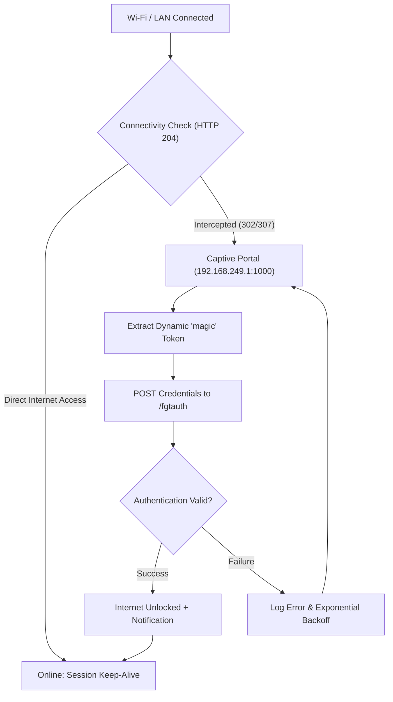

<div align="center">

# ⚡ IIT BHU Wi-Fi & LAN AutoConnect

**Seamless, autonomous Wi-Fi captive portal authentication and keep-alive daemon for laptops.**

[](https://www.python.org/)
[](https://developer.chrome.com/docs/extensions/mv3/intro/)
[](https://github.com/Bssr-cmd/autoconnect_iitbhu)
[](LICENSE)
[-Varanasi-red?style=for-the-badge)](https://iitbhu.ac.in)

<p align="center">
  <a href="#-features">Features</a> •
  <a href="#-how-it-works">How It Works</a> •
  <a href="#-quick-start">Quick Start</a> •
  <a href="#-system-service-setup-auto-start-on-boot">Service Setup</a> •
  <a href="#-browser-extension">Browser Extension</a> •
  <a href="#-security--privacy">Security</a> •
  <a href="#-troubleshooting">FAQ</a>
</p>

</div>

---

## 📌 Problem & Motivation

On the **IIT (BHU) Varanasi** campus network (Wi-Fi & Hostel LAN), the institute firewall (`192.168.249.1` Fortinet FortiGate) forces users through a captive portal login page. 

- Sessions expire every **12–24 hours** or whenever your device disconnects/reconnects.
- On laptops, this constantly interrupts workflow by opening browser popups asking for your Roll Number and Password.
- While mobile apps exist, laptops lacked an automated background solution.

**IIT BHU AutoConnect** solves this entirely by automating the network handshake and keeping your connection alive in the background—**with zero human intervention**.

---

## ✨ Features

- 🔄 **Fully Autonomous Background Daemon**: Detects captive portal redirects silently and authenticates within seconds without opening any browser tabs.
- 💓 **Intelligent Keep-Alive Heartbeat**: Prevents idle disconnects by dispatching periodic lightweight pings to the gateway.
- 🔔 **Cross-Platform Native Notifications**: Sends unobtrusive desktop notifications on successful connection (Linux `notify-send`/`kdialog`, macOS `osascript`, Windows Toast).
- 🔒 **Zero-Trust Local Security**: Credentials are encrypted/obfuscated locally (`~/.config/autoconnect_iitbhu/config.json`) with strict POSIX `0600` permissions (owner-only access).
- 🧩 **Manifest V3 Browser Extension**: Includes a modern Chrome/Brave/Edge extension for instant <100ms form auto-fill & auto-submit.
- 🚀 **1-Click System Service**: Pre-configured `systemd` user service (Linux), `launchd` (macOS), and Windows Startup support.

---

## ⚙️ Architecture & How It Works



```
[ Laptop Connected to Campus Wi-Fi / LAN ]
                   │
                   ▼
       [ Connectivity Probe (204) ]
         │                       │
         ├─ (Online) ────────────┼──────────► [ Active: Keep-Alive Ping (5m) ]
         │                       │
         └─ (302 Intercept) ─────▼
                  [ Captive Portal at 192.168.249.1:1000 ]
                                 │
                                 ▼
                  [ Extract Dynamic 'magic' Token ]
                                 │
                                 ▼
                  [ POST Roll No + Password to /fgtauth ]
                                 │
                                 ▼
                  [ Internet Unlocked Successfully! ]
```

---

## 🚀 Quick Start

### Option A: 1-Click Automated Setup (Linux & macOS)

Clone and run the automated setup wizard:

```bash
git clone https://github.com/Bssr-cmd/autoconnect_iitbhu.git
cd autoconnect_iitbhu
chmod +x install.sh
./install.sh
```

The script will:
1. Install necessary Python dependencies.
2. Prompt securely for your Roll Number and Wi-Fi password.
3. Automatically enable and start the background service so it runs at boot.

---

### Option B: Manual CLI Usage (All Platforms)

#### 1. Install dependencies:
```bash
pip install -r requirements.txt
```

#### 2. Configure credentials:
```bash
python3 autoconnect.py --configure
```

#### 3. Test immediate login:
```bash
python3 autoconnect.py --login
```

#### 4. Check live network status:
```bash
python3 autoconnect.py --status
```

#### 5. Run the background daemon manually:
```bash
python3 autoconnect.py --daemon
```

---

## 🛠️ System Service Setup (Auto-Start on Boot)

### 🐧 Linux (`systemd` User Service)
Runs quietly in the background upon login:

```bash
# Enable and start service
python3 service_installer.py

# Check status
systemctl --user status autoconnect-iitbhu.service

# View live real-time logs
journalctl --user -u autoconnect-iitbhu.service -f

# Stop / Disable service
systemctl --user stop autoconnect-iitbhu.service
```

### 🪟 Windows (Startup Folder)
1. Press <kbd>Win</kbd> + <kbd>R</kbd>, type `shell:startup`, and press <kbd>Enter</kbd>.
2. Create a shortcut in that folder pointing to:
   ```cmd
   pythonw.exe C:\path\to\autoconnect_iitbhu\autoconnect.py --daemon
   ```
   *(Using `pythonw.exe` ensures the daemon runs silently with no console window).*

### 🍎 macOS (`launchd` Agent)
Run:
```bash
python3 service_installer.py
```
This registers a `launchd` service at `~/Library/LaunchAgents/com.iitbhu.autoconnect.plist`.

---

## 🧩 Browser Extension (Manifest V3)

If you prefer using a browser extension instead of or alongside the background daemon:

<div align="center">
  
</div>

1. Open your browser and go to the extensions manager:
   - **Google Chrome / Brave**: `chrome://extensions`
   - **Microsoft Edge**: `edge://extensions`
2. Enable **Developer mode** (toggle in top right).
3. Click **Load unpacked** and select the [`extension/`](extension/) directory.
4. Click the extension toolbar icon, enter your Roll Number & Password, and click **Save Settings**.
5. Whenever the captive portal opens, the extension logs in automatically in **<100ms**.

---

## 🔐 Security & Privacy

| Principle | Guarantee |
| :--- | :--- |
| **No External Traffic** | Your credentials are sent **only** to the local IIT BHU firewall (`192.168.249.1`). |
| **Local Storage Only** | Credentials are stored in `~/.config/autoconnect_iitbhu/config.json` with `0600` permissions (readable solely by your OS user account). |
| **No Tracking / Telemetry** | 0 analytics, 0 external APIs, 0 data collection. |
| **Open Source** | 100% auditable Python and JavaScript codebase. |

---

## 📂 Project Structure

```
autoconnect_iitbhu/
├── autoconnect.py          # Core CLI application & background daemon
├── config.py               # Secure credential storage & encryption manager
├── portal_client.py        # Captive portal detection, token parser & HTTP engine
├── notifier.py             # Cross-platform desktop notification provider
├── service_installer.py    # Cross-platform background service installer
├── install.sh              # 1-Click installation shell script
├── requirements.txt        # Python dependencies
├── generate_icons.py       # Extension icon generator
├── tests/
│   └── test_portal.py      # Unit test suite (token parsing, status tests)
└── extension/              # Manifest V3 Chrome/Edge/Brave Extension
    ├── manifest.json
    ├── content.js          # Captive portal autofill & auto-submit script
    ├── service-worker.js   # Background badge & connectivity watcher
    ├── popup/              # Extension UI (HTML/CSS/JS)
    └── icons/              # Extension icons (16px, 48px, 128px)
```

---

## ❓ FAQ & Troubleshooting

<details>
<summary><b>1. What is <code>http://192.168.249.1:1000</code>?</b></summary>
<code>192.168.249.1</code> is the IP address of the IIT BHU campus firewall gateway. Port <code>1000</code> is the Fortinet captive portal authentication service (<code>fgtauth</code>) that validates user credentials.
</details>

<details>
<summary><b>2. How do I change or reset my saved password?</b></summary>
Simply run:
<pre><code>python3 autoconnect.py --configure</code></pre>
</details>

<details>
<summary><b>3. Does this work on Ethernet (Hostel LAN) as well as Wi-Fi?</b></summary>
Yes! Both IIT BHU campus Wi-Fi and hostel LAN connections share the same captive portal gateway and authentication protocol.
</details>

<details>
<summary><b>4. How do I run the automated unit tests?</b></summary>
Run:
<pre><code>python3 -m unittest discover tests/</code></pre>
</details>

---

## 🤝 Contributing

Contributions, bug reports, and suggestions are welcome!
1. Fork the repository.
2. Create your feature branch (`git checkout -b feature/AmazingFeature`).
3. Commit your changes (`git commit -m 'Add some AmazingFeature'`).
4. Push to the branch (`git push origin feature/AmazingFeature`).
5. Open a Pull Request.

---

## 📄 License

Distributed under the **MIT License**. See [`LICENSE`](LICENSE) for more information.

<div align="center">
  <sub>Crafted for IIT (BHU) Varanasi Campus Network</sub>
</div>
